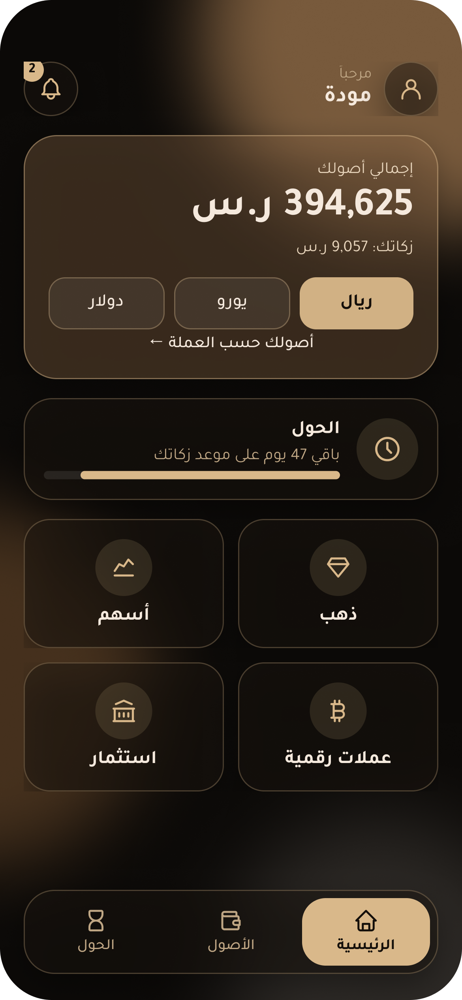
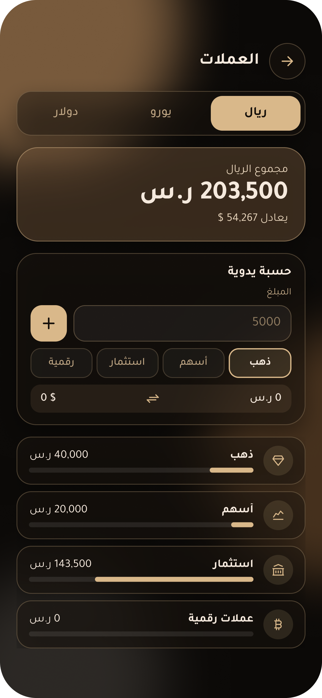
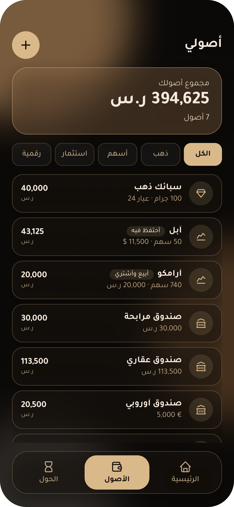
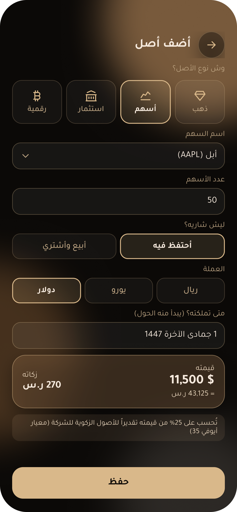
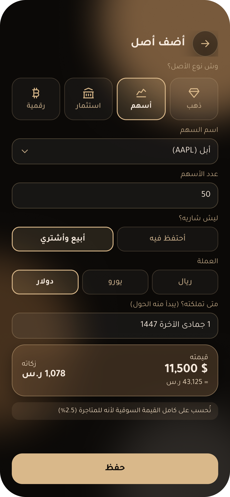
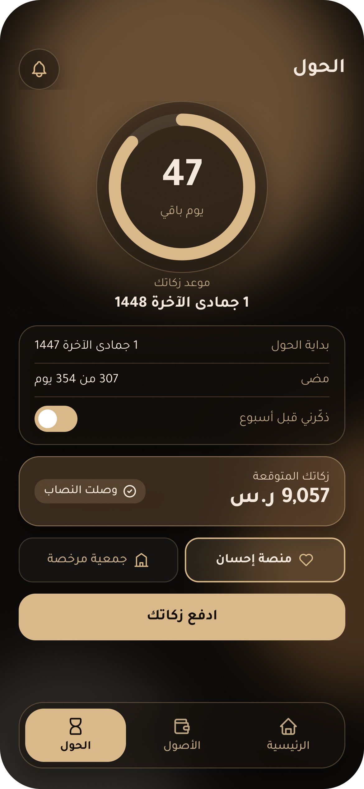

# Mikal · ميكال

**Zakat, measured right.** A mobile app concept that calculates zakat on global, multi‑currency and crypto investments for individuals in Saudi Arabia.

> FTEC341 · FinTech & Financial Transformation · Financial Solutions Project
> College of Business Administration, Princess Nourah bint Abdulrahman University · 1st Semester 2026/2027

**Try the live demo:** open `index.html` in any browser, or visit the hosted version on Netlify.

## The problem

Saudi individuals calculate their own zakat, and more of their wealth now sits outside the local market: Saudi trading in foreign markets reached about SAR 850B in 2025. ZATCA's Zakaty app is useful, but it:

- values every share the same way, without asking whether it is held long‑term or traded;
- does not cover crypto;
- sends zakat only to the Social Security Agency.

## The solution

Mikal brings every asset, in any currency, into one zakat view and calculates zakat by **why** each asset is held.

| Feature | What it does |
|---|---|
| Intent‑based zakat | “Why do you hold it?” Trading → 2.5% of market value. Long‑term → 2.5% of the company’s zakatable assets (≈25% of value when unknown, per AAOIFI Standard 35). |
| Every asset, every currency | Gold, local and foreign shares, funds, cash and crypto in SAR, USD or EUR, converted to SAR. |
| Hawl tracking and payment | Hijri countdown with a reminder, then pay through Ehsan or a licensed charity. |

Example: the same 50 Apple shares → **SAR 270** if held long‑term, **SAR 1,078** if traded.

## Screens (Figma)

| Home | Currencies | Assets |
|---|---|---|
|  |  |  |

| Add asset · Hold | Add asset · Trade | Hawl |
|---|---|---|
|  |  |  |

## Repository contents

- `index.html` — the working web prototype (single file, Arabic RTL).
- `screens/` — the six Figma screens exported at 3x.
- `poster/` — the A1 project poster (PowerPoint, editable).

## Limitations

- Prototype: prices are fixed sample values and payment is simulated.
- Scholars differ on zakat for shares, crypto and jewelry, so results are estimates that need Shariah review.
- No official data link to foreign brokers or crypto wallets, so assets are entered manually.
- A real launch needs Personal Data Protection Law compliance and a formal partnership with Ehsan.

## References

1. Zakat, Tax and Customs Authority. (2024). *Zakaty for individuals’ zakat*. https://zatca.gov.sa/ar/MediaCenter/News/Pages/news-1215.aspx
2. Argaam. (2026). *Saudi trading in foreign markets surges in 2025: Drivers & outlook*. https://www.argaam.com/en/article/articledetail/id/1882771
3. Unlock Blockchain. (2022). *18 percent of Saudi residents trade in crypto*. https://www.unlock-bc.com/en/18-percent-of-saudi-residents-trade-in-crypto
4. Zakat, Tax and Customs Authority. (2025). *Zakaty platform user guide* (3rd ed.). https://www.zatca.gov.sa/ar/HelpCenter/guidelines/Documents/ZakatyManual.pdf
5. Adam, F., Khan, A., & Omarjee, B. (2018). *Zakat on share investments: Determining a proxy for calculation*. National Zakat Foundation. https://nzf.org.uk/knowledge/zakat-on-share-investments-determining-a-proxy-for-calculation/
6. Ehsan National Platform for Charitable Work. (n.d.). *Zakat*. https://ehsan.sa/zakat
